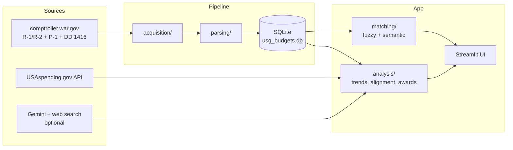

# DoD Budget Explorer

Trace a US defense program from **what was asked for**, to **what Congress
provided**, to **what the money did**, to **what officials said about it** —
in one local tool.

The explorer combines R-1 funding, R-2 justification books, P-1 procurement,
congressional authorization actions, and DD 1416 budget-authority status in a
bundled SQLite database. USAspending.gov supplies live award searches; optional
Gemini features add cited narrative answers and web-grounded context. It can
run locally or as a hosted Streamlit app.

**[Open the free live demo](https://usg-budget-analyzer-mlwcj2nxr2lsg7ppbggg9p.streamlit.app/)**
— Streamlit Community Cloud, connected to `main`, running Python 3.12.
Verified on 2026-11-21: health endpoint, constant-dollar chart, program funding
and execution, and cited narrative retrieval. Paid AI features are disabled.
If the app is asleep, choose **Yes, get this app back up!** and allow startup
to finish. Railway is an optional deployment path, not required for this demo.

## What it does

| Tab | Question it answers |
|---|---|
| **Trends** | How has RDT&E funding moved by component, FY1996–FY2027, in then-year or constant FY2025 dollars? Who got paid from each appropriation account? |
| **Programs** | Which budget program is this name / news quote / PE number? Then a full profile: vintage-labeled funding, request-to-net execution, official plans, awards, and recent coverage |
| **Rhetoric vs. Budget** | Did the money follow the talk? Follow request → separate House/Senate authorization → enacted appropriation → reprogramming → net current program, with optional AI-characterized public emphasis |
| **Coverage** | What's ingested, what's live-queried, and the known blind spots |

Program matching is multi-stage: exact PE-number lookup, lexical matching
over titles/acronyms/project names, and semantic embeddings enriched with
official mission descriptions — with honest ambiguity flagging when several
programs share a name (joint programs usually do).

### Implemented beyond the core funding views

- Shareable URLs restore the main tab, program, profile tab, trend-year range,
  and R-1 dollar basis. Tables provide CSV/XLSX downloads with provenance.
- **Changes between submissions** compares PB vintages and links events to
  program profiles. A command-line exporter writes JSON; scheduled alerts,
  and email delivery are not implemented.
- **Portfolios & watchlists**, in Programs, saves named collections, notes,
  comparison years, dollar basis, and materiality rules in this browser.
  Save from a profile or select up to 100 PE/component pairs. Watchlists compare
  discretionary annual budget-year requests; both dollar and percentage limits
  must be met, with separate flags for presence changes. Missing is not zero or
  evidence of cancellation. Download a JSON backup to restore on another device;
  clearing browser data removes local saves. This is not an account-based sync
  service or a scheduled notification system.
- **Procurement transition** proposes P-1 matches using narrative evidence,
  title similarity, and optional semantic matching. These are inferred leads,
  not an official RDT&E-to-procurement crosswalk.
- **PE lineage** exposes renumbering and narrative transfer evidence in funding
  histories, with visible seams and optional possible links.
- **Ask the justification books** retrieves local R-2 passages without an API
  key. Optional AI answers require valid passage citations; citation validation
  checks the quoted text, not whether every interpretation is correct.
- **Extracted facts** shows source sentences from a resumable batch extraction.
  The shipped sample contains 25 facts from 50 completed narrative extractions;
  this is partial coverage, not a full-corpus extraction.
- **Reconciliation** compares R-1 data with source workbooks and latest DD 1416
  enacted totals with next-cycle R-1 CY figures. Missing workbooks appear as
  `no_reference`; this is not a comprehensive audit against appropriations acts.
- A data dictionary and release-bundle builder are implemented. Publishing a
  GitHub release remains a separate manual step.

## Architecture



## Quickstart (local)

Requires Python 3.12+.

```bash
cd dod_ic_budget_analyzer
pip install -r requirements.txt
python scripts/cache_model.py
streamlit run app.py
```

The requirements select `torch==2.15.0+cpu` from the official PyTorch CPU index
on Linux and Windows, so direct installs on free hosts do not pull unused CUDA
packages. Other platforms use their native torch distribution. Docker and CI
install this same manifest and check that CUDA is absent.

The repository ships with the processed database, so the app is useful
immediately: FY1996–FY2027 R-1 funding, R-2 mission narratives for 1,383 of
2,055 program elements across all five components, and 26,544 congressional
authorization actions from 30 NDAA committee reports covering FY2012–FY2027 in
both chambers. It also includes 79,677 reconciled DD 1416 execution rows from
381 official workbooks (reports dated December 2012 through March 2026).

The database ships **compressed** as `usg_budgets.db.gz` (about 41 MB) because
the roughly 166 MB
raw is past GitHub's per-file limit. It expands itself the first time anything
opens it — no setup step — and the expanded file is gitignored. Run
`scripts/cache_model.py` once with network access to download the embedding
model and verify local encoding before a demo or test run. Corpus retrieval
deliberately loads only cached weights; prebuilt indexes alone are not enough.
Docker performs this preparation during its build.

The shipped database also includes 5,253 P-1 procurement observations
(FY2024–FY2027, from PB2026 and PB2027) and 405 PE lineage records. These counts
were checked against the bundled data on 2026-11-21; they do not imply uniform
coverage across years or components.

### Optional: AI features

Set a Gemini API key to enable ambiguity resolution, "In the News," and the
optional open-source-emphasis layer on the Rhetoric vs. Budget tab. The
congressional requested-vs-authorized figures on that tab need **no key** and
cost nothing per user:

For a one-off local demo, inject the key into the current process rather than
persisting it with `setx`, and bind Streamlit to loopback:

```powershell
$env:GEMINI_API_KEY = Read-Host "Gemini API key" -MaskInput
python -m streamlit run app.py --server.address 127.0.0.1
Remove-Item Env:GEMINI_API_KEY
```

**Keys are per-user and never live in this repository.** The app reads
`GEMINI_API_KEY` (or `GOOGLE_API_KEY`) from the environment — or, on Streamlit
Community Cloud, from the app's Secrets — and nowhere else: there is no key
file, config entry, or Docker build argument for it, and `.env` files are
gitignored as a guardrail. Don't commit credentials in any form.

### AI cost control

Every AI call is cached, metered, and capped. Results that have been fetched
before render as soon as you open the tab; only genuinely new lookups cost
anything, and a monthly ceiling stops fresh calls before a bill can run away.
Knobs live in `config.py` (`AI_MONTHLY_BUDGET_USD`, `AI_FREE_CREDITS_PER_MONTH`,
`AI_CACHE_TTL_DAYS`).

```bash
python -m analysis.ai_budget --report          # month-to-date spend by task
python -m analysis.ai_budget --prune           # drop expired cache rows
python -m analysis.ai_budget --reset-runtime   # clear ALL runtime rows (see below)
python analysis/ai_budget_eval.py              # self-check: cost math + caching rules
```

**Run `--reset-runtime` before rebuilding the shipped archive.** The database is
published in this public repository (compressed, see below), so a dev session's
cached AI results, spend ledger, and search log would otherwise be shipped — and
grounded search results must never be. The command clears those four tables and
VACUUMs the file so deleted rows are not merely unlinked. Verify with:

```bash
sqlite3 data/processed/usg_budgets.db \
  "SELECT COUNT(*) FROM ai_cache WHERE task IN ('find_open_source_hits','annual_signal');"
```

It must return 0.

Warm the cache ahead of time so the app opens with analysis already in place.
It picks targets from real search demand first, then the largest programs:

```bash
python analysis/ai_precompute.py --limit 20 --dry-run   # show the worklist
python analysis/ai_precompute.py --limit 20             # warm it
```

**Two rules the code enforces, both from the
[Gemini API terms](https://ai.google.dev/gemini-api/terms):**

- Results grounded in Google Search are stored **per user and never shared**,
  and always render with Google's Search Suggestions. Match resolution, which
  doesn't use search, is shared across everyone — so a program someone else
  already resolved costs you nothing.
- Web-grounded features **verify that the search actually ran**. This model
  will happily answer a "find recent coverage" prompt from memory, producing
  invented outlets and dates that look identical to real ones. When no search
  happened, the app shows nothing and says why rather than presenting
  recollection as sourced reporting.

## Quickstart (Streamlit Community Cloud)

The free live demo deploys directly from this repository's `main` branch with
main file `dod_ic_budget_analyzer/app.py` and Python 3.12 selected in app settings.
On a fresh instance, the program matcher can download the model; the corpus
search loader invokes it before attempting local retrieval. A no-network
deployment must provision the model cache in advance (use the Docker build).
Two things are specific to the hosted app:

- `.streamlit/config.toml` at the repository root turns the source-file
  watcher off. On a deployment the code only changes on redeploy, and with the
  watcher on Streamlit probes every imported module after each run — which
  makes transformers' lazy vision modules try to import torchvision and logs
  ~150 harmless tracebacks per scan.
- **Leave `GEMINI_API_KEY` out of a public deployment.** Every AI button would
  bill the deployer's key. Anonymous sessions are isolated from one another,
  but a public visitor can still spend a fresh per-session allowance. The app
  degrades cleanly without a key. For a private showing, restrict the app to
  named viewers (or add an OIDC allowlist), add the key under Settings →
  Secrets, and **Reboot** the app. `.streamlit/secrets.toml` is gitignored.

The free app can sleep after inactivity. Open it and exercise a program search
and a corpus question before a presentation so startup and model loading finish
before the audience arrives.

For an application-level allowlist, configure Streamlit OIDC in the app's
Secrets and add the permitted addresses. The gate executes before the database
or any AI controls initialize:

```toml
demo_allowed_emails = ["you@example.com", "attendee@example.com"]

[auth]
redirect_uri = "https://YOUR-APP.streamlit.app/oauth2callback"
cookie_secret = "GENERATE-A-LONG-RANDOM-VALUE"
client_id = "YOUR-OIDC-CLIENT-ID"
client_secret = "YOUR-OIDC-CLIENT-SECRET"
server_metadata_url = "https://accounts.google.com/.well-known/openid-configuration"
```

With local OIDC settings present, the same allowlist can be supplied as the
comma-separated environment variable `DEMO_ALLOWED_EMAILS`. If no allowlist is
configured, the app retains its normal public/degraded behavior.

## Quickstart (Docker)

```bash
cd dod_ic_budget_analyzer
docker compose up --build
```

Then open http://localhost:8501. The compose file mounts `./data` so the
database persists outside the container, passes `GEMINI_API_KEY` through from
your environment, and caches the embedding model in a named volume.

The image is **self-contained** — it carries the compressed database, program
embeddings, narrative passage index, deflator CSV, and downloaded model weights.
It also runs with no checkout and no volume:

```bash
docker build -t budget-explorer . && docker run -p 8501:8501 budget-explorer
```

Under compose the mounted `./data` shadows the copies baked into the image,
which is what you want for local development.

### Optional Railway configuration

For a Railway deployment, select this repository and use
`/dod_ic_budget_analyzer` as the **Root Directory**, so its Dockerfile and build
context agree. Use the Dockerfile's start command; remove any older custom start
command that overrides it. The command listens on Railway's `PORT` (8501 when
unset), and binds to `0.0.0.0`.

Set the service healthcheck path to `/_stcore/health`, and make sure the public
domain targets the same listening port. A successful healthcheck confirms the
server is listening; also exercise Trends, constant dollars, a program profile,
and corpus retrieval after deployment. See Railway's
[Dockerfile detection](https://docs.railway.com/builds/dockerfiles) and
[healthcheck port behavior](https://docs.railway.com/deployments/healthchecks).

Keep Gemini credentials out of a public demo. The Docker image disables runtime
model downloads and the Streamlit source watcher. Docker Compose mounts its
model-cache volume over the baked cache. To populate an existing empty/stale
cache volume, run this network-enabled setup command before starting the service:

```bash
docker compose run --rm -e HF_HUB_OFFLINE=0 -e TRANSFORMERS_OFFLINE=0 budget-explorer python scripts/cache_model.py
```

It needs no API key.

## Verification

From `dod_ic_budget_analyzer/`, after installing `requirements-dev.txt`:

```bash
python scripts/cache_model.py       # network-enabled setup, no API key
python -m pytest -q
python analysis/ai_budget_eval.py
python analysis/narrative_qa_eval.py
```

CI prepares the model explicitly, then runs pytest with `HF_HUB_OFFLINE=1` and
`TRANSFORMERS_OFFLINE=1`. It also builds the Docker image, checks its data and
retrieval with container networking disabled, and tests startup on `PORT=8080`.
No paid AI call is required. The local recovery check on 2026-11-21 passed
97 tests, 64/64 AI governance checks, and 5/5 gated narrative retrieval cases.
The program-linker evaluation also passed 11/11. Linux tests and Docker smoke
checks passed on GitHub for the merged recovery and CPU-install revisions.
The additional regression test covers the constant-dollar toggle and permalink;
fiscal years must be numeric before applying the deflator.

## Updating the data

New budget cycle? Three commands:

```bash
# 1. Official R-1 spreadsheet (machine-readable, FY2012+)
python acquisition/comptroller_scraper.py --xlsx --years 2028 --exhibits rdtee

# 2. Parse and save
python parsing/xlsx_ingest.py --file data/raw/comptroller/2028/rdtee/fy2028_r1.xlsx --save

# 3. R-2 justification books (Defense-Wide XML) + ingest
python acquisition/r2_downloader.py --years 2028 --ingest
```

Then ingest the new parquet into SQLite with `storage/ingest_r1.py` (see the
notebook in `notebooks/` for the pattern). Matching quality is guarded by a
golden-set eval — run it after any matcher change:

```bash
python analysis/linker_eval.py
```

Structured narrative facts are a bounded, paid build step over PE-level R-2 text. Run
`python -m analysis.narrative_extract --dry-run --limit N` to inspect the worklist and
worst-case cost before using `--run --limit N`; `narrative_extractions` durably records
completed text even when it yields no facts, so later batches resume after runtime tables
are cleared.

**Rebuild the shipped archive after any ingest**, or the next clone gets stale
data — the raw `.db` is gitignored and only the `.gz` is published:

```bash
python -m analysis.ai_budget --reset-runtime          # never ship AI runtime rows
python -m storage.build_archive                       # atomic gzip rebuild
```

R-2 narrative search uses a separate, tracked passage index so long narratives
are retrieved without truncation. Rebuild it after changing the shipped
narrative corpus:

```bash
python -m storage.build_narrative_index
```

Service-branch R-2 narratives (Army, Navy, Air Force, Space Force) come from
their PDF justification books:

```bash
python acquisition/service_r2_downloader.py --service army navy --years 2028 --ingest
```

Quarterly execution updates are machine-readable and key-free:

```bash
python -m storage.ingest_dd1416 --years 2028 --download
```

`data/raw/` is not tracked (re-downloadable PDFs/XLSX/XML); the pipeline above
rebuilds it. Pre-FY2012 years came from parsed PDFs and are already in the
shipped database.

## Data releases

A data release bundle contains the tracked compressed SQLite archive, all 30
R-1 parquet exports, the RDT&E deflator CSV, `DATA_DICTIONARY.md`, a JSON
manifest with table counts and source-document provenance, and release notes
that compare row counts with the newest earlier bundle.

Build a verified bundle from the repository root with:

```bash
cd dod_ic_budget_analyzer
python scripts/build_release.py
```

The script scrubs the ignored working database, verifies the tracked archive
independently, and writes the bundle under `release/`. Attaching that directory
to a GitHub release remains a manual step; the script does not upload or run Git
commands.

## Data sources & honesty notes

- **R-1 exhibits** (comptroller.war.gov): official XLSX for FY2012–FY2027,
  parsed PDFs for earlier PB cycles. Each observation records its source PB
  submission; discretionary and reconciliation/mandatory funds remain
  separate. Trend views can use the RDT&E-specific Green Book deflator.
- **DD 1416 quarterly execution reports** (comptroller.war.gov): official XLSX
  rows keyed by program element, including President's request, enacted
  appropriation, statutory changes, above- and below-threshold reprogramming,
  and net current program. These are budget-authority status reports, not
  obligations or outlays. The corpus contains every downloadable RDT&E workbook
  discovered on the FY2013–FY2026 index pages; eight FY2021 links published with
  a nonexistent `6_31` directory return 404 and are therefore disclosed gaps.
- **R-2 justification books**: Defense-Wide via official DTIC-schema XML
  (PB2026 cycle onward); Army and Navy via the PDF books those departments
  publish; Air Force and Space Force via the Internet Archive, because their
  own host aborts the TLS handshake against every client. Parsed from the PDF
  text layer, which prints the program element verbatim in every exhibit
  header, so the join is exact rather than fuzzy. Mission descriptions,
  projects, and per-year accomplishment line items.
  **Narrative coverage is 1,383 of 2,055 program elements (67%)** — Air Force
  389, Army 346, Navy 296, Defense-Wide 282, Space Force 67, OT&E 3 — spanning
  FY2018–FY2027. Coverage is uneven by design of the sources: Army published no
  RDT&E books for FY2023, and the Internet Archive holds Air Force and Space
  Force books only through FY2024 and rate-limits retrieval to a few documents
  at a time, so that backfill converges over repeated runs.
- **NDAA authorization committee reports** (govinfo.gov): the RDT&E funding
  tables printed in HASC/SASC reports, parsed to per-program-element
  requested / committee change / authorized figures plus the committee's own
  stated reason. Key-free and, as US Government works (17 U.S.C. 105), public
  domain. **Machine-readable tables begin at FY2012** — earlier reports print
  them as GRAPHIC images, so an absent year means "not available," not "no
  action taken." A program element can hold several lines in one report (one
  per budget activity); those are summed per fiscal year, while House and
  Senate are never pooled because they score the same request separately.
  Authorization is not appropriation.
- **USAspending.gov**: live queries. Public award records carry **no
  program-element linkage**, so program-level award search is keyword
  matching — the UI labels it "leads, not a ledger." Other Transactions
  aren't a searchable instrument group; DoD awards post with a ~90-day
  delay; umbrella vehicles (PIAs, IDIQs) hide task detail in generic prime
  descriptions (a subaward search partially compensates).
- **Change-feed interpretation**: absence from a newer submission is currently
  labeled a termination; a newly observed PE is labeled a new start.
  Renumbering, transfers, and coverage gaps can produce these events. Review
  lineage and source evidence before treating them as confirmed decisions.
- **AI enrichment**: clearly labeled as AI estimates. The Rhetoric vs.
  Budget signal is an LLM characterization grounded in web search, not a
  media-analytics count; its alignment coefficient is a Spearman rank
  correlation at 0–2-year funding leads and refuses to compute on fewer
  than 4 overlapping years. Both web-grounded features discard output the
  model produced without actually searching, so an empty panel means "nothing
  retrieved," never "here's what I vaguely recall."

## Project layout

```
dod_ic_budget_analyzer/
├── acquisition/     # downloaders: R-1/R-2, DD 1416, USAspending
├── parsing/         # R-1/R-2 and DD 1416 parsers
├── storage/         # SQLAlchemy schema + ingest pipelines
├── matching/        # normalizer, fuzzy matcher, semantic matcher
├── analysis/        # trends, program linker, awards, rhetoric alignment, eval
├── data/processed/  # SQLite DB, parquet, embedding cache (tracked)
├── data/raw/        # source documents (not tracked; rebuildable)
└── app.py           # Streamlit UI
```

## Next work

See [ROADMAP.md](ROADMAP.md) for implemented capabilities, remaining limits,
and proposed next steps: repeatable demo operations, safer change classifications,
briefing exports, shared portfolio workflows, and a measured management pilot. Saved
browser portfolios and watchlists are implemented. P-1 ingest,
lineage, reconciliation, cited retrieval, JSON change export, and the release
builder are already implemented; extending their coverage and operating them
reliably is distinct from building them for the first time.
